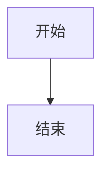

这一篇告诉你**以后怎么写文章**。先看整体流程，再逐条看细节。

## 一、文件放哪

站点直接读取 `content/` 目录，也就是用 Obsidian 打开的那个 vault：

```
content/
├── index.md              ← 首页
├── about/                ← 关于本站
│   ├── index.md          ← 分类的「目录页」
│   ├── writing-guide.md
│   └── components.md
├── business/             ← 知识库分类：业务分享
│   └── index.md
├── industry/             ← 知识库分类：行业知识
├── tools/                ← 知识库分类：工具资源
├── tech/                 ← 技术手记（按时间倒序）
│   └── 2026-10-19-hello.md
└── attachments/          ← 图片等附件
```

**知识库文章 → `content/<分类>/<文件名>.md`，技术手记 → `content/tech/<日期>-<标题>.md`。**

文件名就是网址：`content/business/2026-q1-retro.md` 对应 `/business/2026-q1-retro`。

## 二、一篇文章的样子（front matter）

每篇文章开头用 `---` 包起来的一段元信息：

```yaml
---
title: 环境准备
description: 安装前的系统依赖与版本确认
date: 2026-10-20
tags:
  - 部署
---
```

| 字段          | 作用                                            | 是否必填 |
| ------------- | ----------------------------------------------- | -------- |
| `title`       | 文章标题（也是侧边栏显示名，同时渲染成页面 h1） | 必填     |
| `description` | 摘要，用于 SEO 和列表页                         | 建议写   |
| `date`        | 日期，博客必填；知识库可选                      | 博客必填 |
| `tags`        | 标签，会出现在标签页和文章顶部                  | 可选     |
| `aliases`     | 别名，用于跳转                                  | 可选     |

> [!warning] 正文里不要再写一级标题
> 页面 h1 由 front matter 的 `title` 自动生成。正文里再写一个 `# 标题` 会出现两个大标题。

## 三、怎么分类（新增一个主题）

1. 在 `content/` 下建一个文件夹，例如 `docker/`；
2. 里面放一个 `index.md`，写上分类名和介绍：

```md
---
title: Docker
description: 容器化部署相关的一切
---

这里是 Docker 分类的说明，会显示在分类页顶部。
```

3. 往里放 `.md` 文章。

保存提交后，**侧边栏会自动出现「Docker」分组**，分类页会自动列出里面的文章，不用改任何代码。

## 四、常用 Markdown

```md
## 二级标题

### 三级标题

**加粗** _斜体_ ~~删除线~~ `行内代码`

- 无序列表

1. 有序列表

- [x] 任务列表

[链接文字](../about/) 

| 表格 | 列  |
| ---- | --- |
| 值   | 值  |

> 引用块
```

## 五、提示框（Callout）

用 Obsidian 的标准写法，`[!类型]` 后面跟标题：

```md
> [!tip] 标题
> 内容
```

类型有 `note / tip / info / caution / warning / danger` 六种。标题后面加 `-` 默认折叠、加 `+` 默认展开：

```md
> [!tip]- 点开看细节
> 折叠起来的内容
```

> [!tip] 和旧站的区别
> 旧站在 Docusaurus 里用的 `::::tip[标题]` 四冒号写法，Quartz 里全部改成了上面的 `> [!tip]` 写法。功能一样，但语法是 Obsidian 原生的。

## 六、代码块

只要记住「三个反引号」：

````md
```bash
sudo apt update
```
````

- 第一行写语言名（不写也行，只是没有高亮）
- 最后一行再写三个反引号收尾

常用语言名：`bash` `js` `jsx` `ts` `json` `yaml` `html` `css` `python` `sql`

想显示文件名：

````md
```jsx title="Hello.js"
export default function Hello() {
  return <div>你好</div>
}
```
````

想高亮某几行（大括号里写行号）：

````md
```python {2,4}
...
```
````

## 七、Mermaid 图

````md

````

## 八、数学公式

行内 `$E = mc^2$`，块级用 `$$ … $$` 包起来。

## 九、脚注

```md
文字[^1]

[^1]: 脚注内容
```

## 十、折叠块

```md
<details>
  <summary>点我展开</summary>
  隐藏内容
</details>
```

## 十一、Wiki 链接

Obsidian 的双向链接语法，指向别的笔记，文件名改了也不会断：

```md
[[writing-guide]]
[[about/writing-guide|显示成别的文字]]
```

跨目录也可以：`[[business/2026-q1-retro]]`。普通相对链接 `[文字](../about/)` 同样可用，两种混着写没问题。

> [!warning] 按文件名或路径写，不要按标题写
> 笔记叫 `writing-guide.md`，就要写 `[[writing-guide]]` 或 `[[about/writing-guide]]`；写 `[[写作指南]]`（页面标题）会变成死链。

## 十二、图片

图片统一放 `content/attachments/`，用相对路径引用：

```md

```

在 Obsidian 里直接拖图片进笔记，它会自动存到附件目录并插好链接。

## 十三、博客怎么写

```yaml
---
title: 文章标题
description: 一句话摘要
date: 2026-10-20
tags:
  - 部署
  - 排错
---
```

技术手记放在 `content/tech/`，建议文件名用 `日期-短标题`，例如 `2026-10-20-first-deploy.md`。

## 十四、本地预览与发布

```bash
cd ~/sites/yyj-quartz
export PATH=$HOME/.local/node/bin:$PATH
npx quartz build --serve      # 本地预览 http://localhost:8080
```

改完提交推上去，GitHub Actions 自动构建发布：

```bash
git add .
git commit -m "写一篇新文章"
git push
```

> [!note] 在 Obsidian 里写
> 用 Obsidian 打开 `~/sites/yyj-quartz/content` 这个目录即可，图片和 wiki 链接都会自动处理。Obsidian 的预览效果与线上一致，因为它和 Quartz 用的是同一套 Markdown 语法。

## 十五、写文章要遵守的几条

1. 一篇文章一个主题，标题用「做什么」而不是「标题党」；
2. 正文多用小标题分段，长段落拆开；
3. 代码块写清语言和文件名，命令写清在哪台机器执行；
4. 图片放 `content/attachments/`，用相对路径引用；
5. 改完本地 `npx quartz build --serve` 看一眼再提交。
